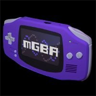

<p align="center">
  
</p>

<h1 align="center">mGBA for Android</h1>

<p align="center">
  <b>High-performance, standalone Game Boy Advance, Game Boy Color, and Game Boy emulator for Android powered by the upstream mGBA 0.10.5 core.</b>
</p>

<p align="center">
  
  
  
  
</p>

<p align="center">
  <a href="#-english"><b>🇬🇧 English</b></a> &nbsp;•&nbsp; <a href="#-русский"><b>🇷🇺 Русский</b></a>
</p>

---

# 🇬🇧 English

## 📖 About The Project

**mGBA for Android** is a standalone, modern emulator for Android devices. Unlike bulky multi-system frontends, this app is built purely for handheld Nintendo classics: it directly bundles the cycle-accurate **mGBA 0.10.5** engine via C NDK and wraps it in a sleek, high-refresh-rate **Jetpack Compose Material 3** interface.

The emulator is optimized out of the box for smartphones, Android gaming handhelds (Retroid Pocket, AYN Odin, Anbernic, Logitech G Cloud), and external controllers (Xbox, PlayStation, Nintendo Switch) with 0 ms input latency.

---

## ✨ Features

### 🕹️ Core & Performance
- **Upstream mGBA 0.10.5 Engine**: Industry-standard cycle-accurate emulation of Game Boy Advance (GBA), Game Boy Color (GBC), and original Game Boy (GB).
- **Sub-frame Input Latency**: Physical gamepad input bypasses Android UI queues through direct low-level key dispatching.
- **Studio-Quality Audio**: Built-in **AAudio / Oboe** low-latency audio engine (48 kHz stereo, jitter-free buffer sync).
- **Hardware Rendering**: OpenGL ES 3.0 supporting Native 3:2 aspect ratio, Pixel-Perfect Integer scaling, stretch modes, Bilinear filtering, and retro LCD subpixel grids.

### 🎮 Controls & Gamepads
- **On-Screen Touch Overlay**:
  - Choice of layout: **Classic Directional D-Pad with arrows** or **Smooth Analog Stick**.
  - One-tap toggle to completely hide all on-screen controls when playing with a physical controller.
  - Accurate 8-directional angle mapping for smooth diagonals in action platformers.
  - Zero unwanted haptic vibrations for clean, tactile touch gaming.
- **Physical Gamepads & Handhelds**:
  - Full automatic detection for Xbox, DualSense/DualShock, Nintendo Switch, and built-in handheld buttons.
  - Dedicated controller remapping screen with instant keycode capture.
  - Standard Xbox button naming convention (LB/RB, LT/RT, A/B/X/Y).
  - Nintendo / Xbox A-B layout inversion switch.

### 💾 Saves & Storage
- **Built-in Save Manager**: Manage, backup, and restore game saves directly in the app without needing external file explorers.
- **Import & Export**: Effortlessly export `.sav` battery saves and `.ss` savestates to your device's Downloads folder or cloud drives.
- **Rock-solid Persistence**: Fully compliant with modern Android Scoped Storage (files saved safely under `Android/data/com.retro.mgba/files/`).

### 🖼️ Library & Cover Art
- **Adaptive Platform Tabs**: Empty platforms are automatically hidden; the "All" tab appears only when 2 or more systems are present.
- **Custom Box Art**: Assign custom box art images from your device's gallery or enjoy retro procedural cartridge canvases.

### 🌐 Internationalization (22 Languages)
Full localization across 22 languages: English, Russian, German, French, Spanish, Italian, Portuguese, Chinese, Japanese, Korean, Ukrainian, Polish, Dutch, Swedish, Turkish, Arabic, Hindi, Thai, Vietnamese, Indonesian, Czech, and Greek.

---

## 🏛️ Upstream Base Core: mGBA

This application is powered by the open-source **[mGBA](https://mgba.io/)** emulator project (source repository: [github.com/mgba-emu/mgba](https://github.com/mgba-emu/mgba)), developed by **Jeffrey Pfau (endrift)** and contributors under the **Mozilla Public License 2.0 (MPL-2.0)**.

We build the official upstream mGBA 0.10.5 C codebase as a high-performance ARM64 shared library (`libmgba_core.so`) via the Android NDK, providing an open, modern mobile frontend on top.

---

## 👥 Authors & Credits

- **Inner Dev** ([innernode.dev@gmail.com](mailto:innernode.dev@gmail.com)) — Lead Android Developer, architecture, NDK integration, and maintainer.
- **KatOriginal** — Co-Author, concept creator, and lead QA tester.
- **Jeffrey Pfau** and all [mGBA contributors](https://mgba.io/) — creators of the mGBA core.

---

## 🤝 Contributing, Forks & Issues

The project is developed in the spirit of free and open-source software. We welcome community forks, pull requests, and bug reports:

1. **Fork** the repository.
2. Create your feature branch: `git checkout -b feature/awesome-feature`
3. Commit your changes: `git commit -m 'Add awesome feature'`
4. Push to the branch: `git push origin feature/awesome-feature`
5. Open a **Pull Request**.

For bug reports, questions, or collaboration, feel free to email:  
📩 **[innernode.dev@gmail.com](mailto:innernode.dev@gmail.com)**

---

## 🛠️ Building from Source

### Prerequisites:
- Android Studio Hedgehog / Iguana / Jellyfish (or newer)
- Android SDK 34 (API 34)
- Android NDK 26.1.10909125
- CMake 3.22.1
- JDK 17

### Build Release APK:
```bash
git clone https://github.com/innernode/mgba-android.git
cd mgba-android
./gradlew assembleRelease
```
The compiled APK will be located at:  
`app/build/outputs/apk/release/app-release.apk`

---

# 🇷🇺 Русский

## 📖 О проекте

**mGBA for Android** — это автономный (standalone) эмулятор нового поколения для Android. В отличие от громоздких мультисистемных оболочек, проект создан специально для классики Nintendo: он напрямую интегрирует официальное ядро **mGBA 0.10.5** через C NDK и современный пользовательский интерфейс **Jetpack Compose Material 3** в эстетике DuckStation.

Эмулятор оптимизирован для смартфонов, портативных консолей (Retroid Pocket, AYN Odin, Anbernic, Logitech G Cloud) и внешних геймпадов (Xbox, PlayStation, Nintendo Switch) с честной задержкой ввода 0 мс.

---

## ✨ Основные возможности

### 🕹️ Ядро и производительность
- **Оригинальное ядро mGBA 0.10.5**: эталонная циклическая точность (cycle-accurate) эмуляции Game Boy Advance (GBA), Game Boy Color (GBC) и Game Boy (GB).
- **Сверхнизкий инпут-лаг**: перехват кнопок физического геймпада на низком уровне без задержек системного интерфейса.
- **Звук студийного качества**: аудио-движок на базе **AAudio / Oboe** (48 kHz, стерео, плавная синхронизация без заиканий).
- **Аппаратный рендерер**: OpenGL ES 3.0 с поддержкой оригинальных пропорций 3:2, целочисленного масштабирования (Pixel-Perfect), растягивания, билинейного сглаживания и ретро-сетки LCD.

### 🎮 Управление и геймпады
- **Сенсорный оверлей**:
  - Выбор стиля: аутентичная **крестовина со стрелочками** или **плавный аналоговый стик**.
  - Быстрое скрытие виртуальных кнопок в один клик при игре с физического контроллера.
  - Точный 8-позиционный расчет диагоналей для комфортного прохождения платформеров.
  - Отключение лишних вибраций для максимального удобства.
- **Физические контроллеры**:
  - Поддержка геймпадов Xbox, PlayStation, Nintendo Switch и встроенных кнопок портативок.
  - Экран переназначения кнопок с моментальным захватом нажатий.
  - Стандартные обозначения кнопок Xbox (LB/RB, LT/RT, A/B/X/Y).
  - Переключатель инверсии раскладки A/B (Nintendo / Xbox).

### 💾 Сохранения и хранилище
- **Встроенный менеджер сохранений**: импорт, экспорт, просмотр и удаление сохранений прямо в приложении без сторонних проводников.
- **Экспорт в один клик**: выгрузка файлов `.sav` и быстрых сохранений `.ss` в папку «Загрузки» или облако.
- **Надёжность Scoped Storage**: безопасное хранение файлов по пути `Android/data/com.retro.mgba/files/`.

### 🖼️ Библиотека игр и обложки
- **Адаптивные вкладки систем**: пустые платформы автоматически скрываются; вкладка «Все» появляется только при наличии 2 и более платформ.
- **Кастомные обложки**: выбор изображений для игр из галереи устройства или использование стильных процедурных картриджей.

### 🌐 Мультиязычность (22 языка)
Интерфейс переведён на 22 языка: русский, английский, немецкий, французский, испанский, итальянский, португальский, китайский, японский, корейский, украинский, польский, нидерландский, шведский, турецкий, арабский, хинди, тайский, вьетнамский, индонезийский, чешский и греческий.

---

## 🏛️ Базовое ядро: mGBA

Этот проект основан на официальном открытом исходном коде эмулятора **[mGBA](https://mgba.io/)** ([github.com/mgba-emu/mgba](https://github.com/mgba-emu/mgba)), созданном **Jeffrey Pfau (endrift)** под свободной лицензией **Mozilla Public License 2.0 (MPL-2.0)**.

Мы собираем оригинальное ядро mGBA 0.10.5 на C под ARM64 в нативную библиотеку `libmgba_core.so` через Android NDK и предоставляем для него современную мобильную оболочку с открытым кодом.

---

## 👥 Авторы и благодарности

- **Inner Dev** ([innernode.dev@gmail.com](mailto:innernode.dev@gmail.com)) — Разработчик приложения, архитектура мобильного порта и мейнтейнер.
- **KatOriginal** — Со-автор идеи, концепт-дизайнер и главный тестировщик.
- **Jeffrey Pfau** и контрибьюторы проекта [mGBA](https://mgba.io/) — создатели великого ядра mGBA.

---

## 🤝 Форки, улучшения и пулл-реквесты

Проект полностью открыт для сообщества:

1. Сделайте **Fork** репозитория.
2. Создайте ветку: `git checkout -b feature/awesome-feature`
3. Зафиксируйте изменения: `git commit -m 'Add awesome feature'`
4. Отправьте изменения: `git push origin feature/awesome-feature`
5. Откройте **Pull Request**.

По любым вопросам и предложениям пишите на почту:  
📩 **[innernode.dev@gmail.com](mailto:innernode.dev@gmail.com)**

---

## 📜 Лицензия / License

Ядро **mGBA** и нативный интерфейс распространяются под условиями свободной лицензии **Mozilla Public License 2.0 (MPL-2.0)**. Полный текст доступен в файле [LICENSE](LICENSE) или на сайте [mozilla.org/MPL/2.0/](https://www.mozilla.org/en-US/MPL/2.0/).
